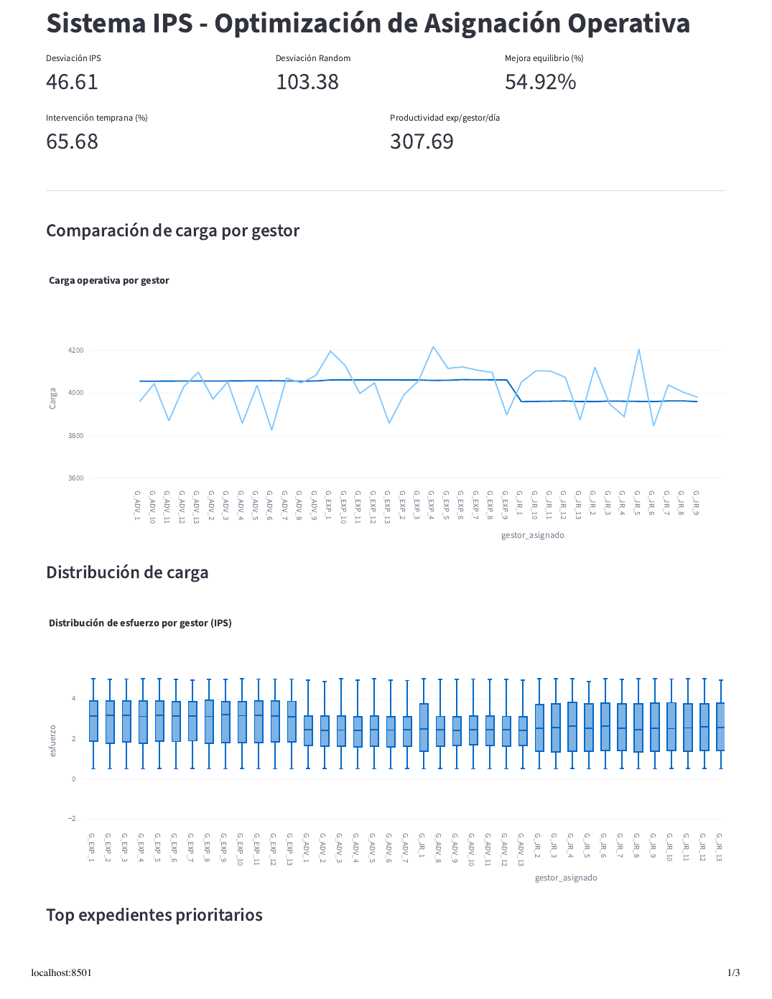
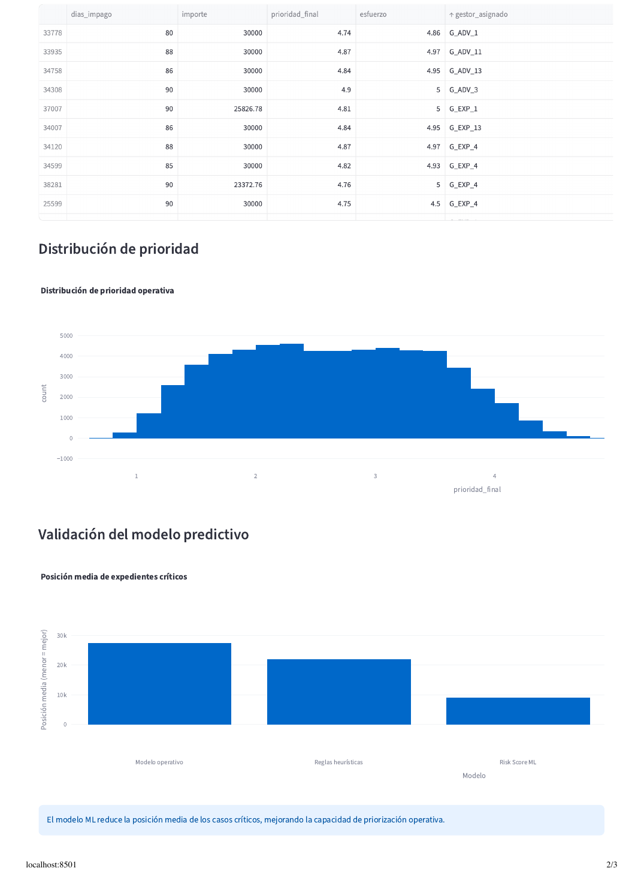
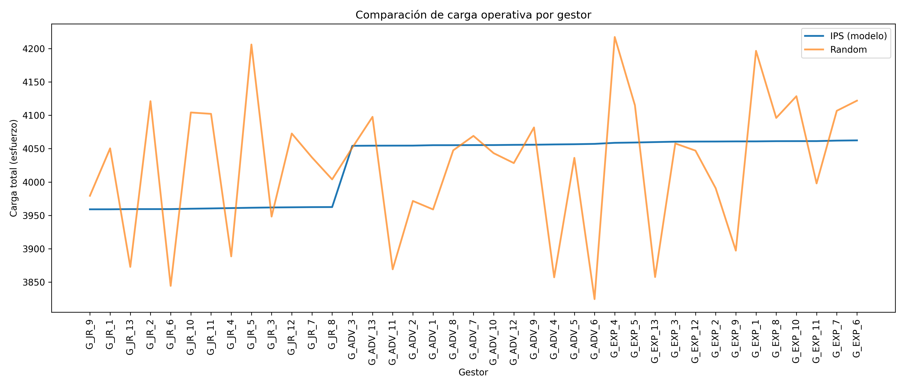

# IPS System — Intelligent Prioritization & Workload Allocation

Prioritization and workload-allocation system for early-stage debt-recovery cases. It combines a weighted scoring engine, a Random Forest risk model and a load-aware assignment algorithm, with a Streamlit dashboard. Evaluated on **synthetic data** only.

> Academic / portfolio project, developed for a university industry challenge (Universidad de Málaga). It is a prototype, not a production system.

## Project overview

IPS (Intelligent Prioritization System) takes a daily batch of overdue cases and decides **what to work on first** and **who should handle it**. The simulation covers 60,000 cases (≈5 operating days) distributed among 39 managers split into three seniority profiles (13 Junior, 13 Advanced, 13 Expert).

## Problem

Splitting work evenly among agents looks fair but is inefficient in practice:

- Cases with the same nominal value do not require the same effort.
- Every extra day overdue lowers the chance of recovering the debt (time window of 1–90 days).
- Deciding manually what to work on and who gets what consumes operating capacity.
- Difficult cases end up with less experienced agents, while workload becomes unbalanced.

In generic terms, this is a **workload / capacity allocation** problem under time pressure.

## Solution

1. **Score** each case with a weighted, multi-variable priority.
2. **Estimate the effort** each case requires.
3. **Rank** cases by *operational value* = priority / effort.
4. **Assign** each case to a manager: complex cases go to senior profiles, unless that would unbalance the load beyond a tolerance.
5. **Compare** against a random-assignment baseline and expose the KPIs in a dashboard.

## Machine Learning approach

- A `RandomForestClassifier` (100 trees, `random_state=42`) is trained on four features — `dias_impago`, `importe`, `historial`, `prioridad_base` — to predict a criticality label (`es_critico = prioridad_base >= 4`). Its predicted probability is used as `risk_score`.
- The `risk_score` is one component (15 %) of the final priority score:

| Component | Weight |
|---|---|
| Days overdue (scaled 1–5) | 0.35 |
| Base priority | 0.20 |
| Amount (scaled 1–5) | 0.15 |
| Case history | 0.15 |
| ML risk score | 0.15 |
| Reactivation boost | +0.5 (fixed) |

- `esfuerzo` (effort) = 0.50·history + 0.30·days + 0.20·priority; `valor_operativo` = `prioridad_final` / `esfuerzo`.
- Assignment is greedy over the ranked queue: a case is assigned to the least-loaded manager of the "ideal" profile, unless that manager exceeds the global minimum load by more than a tolerance (100 effort units), in which case it overflows to the globally least-loaded manager.

The weights were set with operational reasoning and were **not** learned or tuned from labelled outcomes (see [Limitations](#limitations)).

## Architecture

```
genera_csv.py ──► expedientes_gyar.csv ──► motor_predict.py ──► ips_modelo.csv ──┐
 (synthetic data)      (input)              (ML + scoring +      baseline_aleatorio.csv ──► app_predict.py
                                             assignment + KPIs)   + PNG charts               (Streamlit dashboard)
```

## Technologies used

Python · pandas · NumPy · scikit-learn · Matplotlib · Seaborn · Streamlit · Plotly

## Project structure

```
IPS-System/
├── README.md
├── HOW_TO_RUN.md
├── LICENSE
├── requirements.txt
├── .gitignore
├── src/
│   ├── genera_csv.py        # Synthetic dataset generator (60,000 cases, seed 42)
│   ├── motor_predict.py     # Final engine: RF risk score, scoring, assignment, KPIs, charts
│   └── app_predict.py       # Streamlit dashboard
├── iterations/              # Earlier, rule-based versions of the engine and dashboard
├── data/
│   ├── README.md            # Data description
│   └── sample/              # 1,000-row sample of the synthetic input
└── docs/images/             # Charts and dashboard screenshots
```

> Note: code comments, variable names and column names are in Spanish (`expediente` = case, `gestor` = manager, `esfuerzo` = effort, `dias_impago` = days overdue).

## How to install

```bash
git clone git@github.com:santicaleroo05/IPS-System.git
cd IPS-System
python -m venv .venv && source .venv/bin/activate
pip install -r requirements.txt
```

## How to run

Full guide with expected output and troubleshooting: [HOW_TO_RUN.md](HOW_TO_RUN.md). Quick version:

The scripts read and write files in the **current directory**, so run them from `src/`, in this order:

```bash
cd src
python genera_csv.py       # 1. generates expedientes_gyar.csv
python motor_predict.py    # 2. generates ips_modelo.csv, baseline_aleatorio.csv and PNG charts
streamlit run app_predict.py   # 3. launches the dashboard
```

`motor_predict.py` opens Matplotlib windows (`plt.show()`); close them to let the script finish, or run with `MPLBACKEND=Agg python motor_predict.py`.

## Dashboard

The Streamlit dashboard shows global KPIs (load deviation IPS vs. random, improvement, early intervention, productivity), load per manager, effort distribution per manager, the top-20 priority cases, the priority distribution and a comparison of the mean queue position of "critical" cases under three rankings (operational value, rule-based priority and ML risk score).




## Results / performance

Running the pipeline as-is (seed 42, 60,000 synthetic cases, 39 managers) produces:

| Metric | Value |
|---|---|
| Load std. deviation — IPS | 46.61 |
| Load std. deviation — random assignment | 103.38 |
| Improvement in load balance | 54.92 % |
| Early intervention (≤ 60 days, within capacity) | 65.68 % |
| Avg. cases per manager per day | 307.69 |
| Critical cases (`prioridad_final ≥ 4`) handled by Experts | 49.85 % |



These figures were obtained on synthetic data and only show that the pipeline behaves as designed. **They are not evidence of real-world performance.**

## Limitations

- **Synthetic data only.** The dataset follows distributions defined by the generator; it does not reflect real cases or real recovery outcomes.
- **The ML label is not an outcome.** `es_critico` is derived from `prioridad_base`, which is also an input feature, so the model largely re-learns a rule (target leakage). The risk score has not been validated against real results, and the model is fitted on 80 % of the data but scores all of it.
- **Weights and tolerance are not calibrated.** They were chosen by operational reasoning, not optimized on labelled history.
- **The baseline is simple.** It is a purely random assignment, so the improvement measures load balance only, not recovery rate.
- **"Effort" is a heuristic**, not measured handling time.
- **Path handling.** Scripts use relative file paths and must be run from `src/`.
- **Early-intervention KPI** depends on the assumed capacity (300 cases/manager/day) and the five-day window.

## Disclaimer

This is an independent educational project built on fully synthetic data. It contains no real customer, personal or company data. It is not affiliated with, endorsed by or a product of any company, and its results must not be read as representing the performance or processes of any real operation.

## License

Released under the [MIT License](LICENSE).
